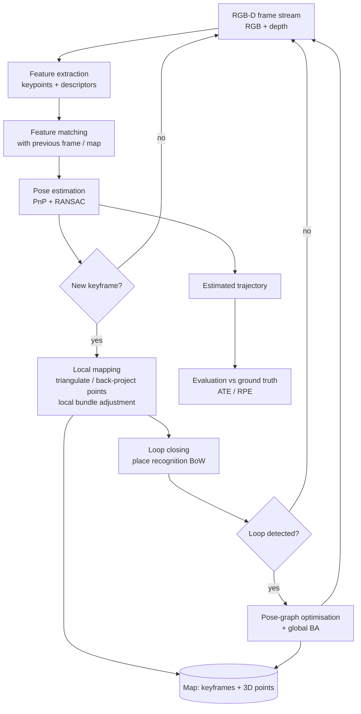

# Robotics Visual SLAM on Colab

**Understanding, running and evaluating a visual SLAM pipeline (RGB-D, TUM dataset) using [pySLAM](https://github.com/luigifreda/pyslam), entirely on free Google Colab — no local GPU required.**

> **Status:** 🚧 In progress. This README describes the concepts, the plan and the evaluation protocol. Results sections are filled in as each milestone is completed (see [Roadmap](#6-roadmap-and-progress)).

---

## Table of contents

1. [Project goal](#1-project-goal)
2. [What is SLAM?](#2-what-is-slam)
3. [Concepts and mathematics](#3-concepts-and-mathematics)
4. [System architecture](#4-system-architecture)
5. [Dataset and evaluation protocol](#5-dataset-and-evaluation-protocol)
6. [Roadmap and progress](#6-roadmap-and-progress)
7. [Requirements](#7-requirements)
8. [How to reproduce](#8-how-to-reproduce)
9. [Repository structure](#9-repository-structure)
10. [Results](#10-results)
11. [Limitations and honest notes](#11-limitations-and-honest-notes)
12. [References and credits](#12-references-and-credits)

---

## 1. Project goal

This is a self-driven learning project with two aims:

1. **Understand** how a modern feature-based visual SLAM system works end to end: tracking, mapping, loop closure and optimisation.
2. **Evaluate** such a system the way it is done in research: run it on a public benchmark, measure trajectory error against ground truth, and analyse *why* it drifts or fails.

The project does **not** re-implement SLAM from scratch. It builds on the open-source **pySLAM** framework as the baseline and adds its own experiments, analysis and (optionally) a learned component on top.

**Research questions explored**

- How accurate is a feature-based RGB-D SLAM pipeline on standard sequences, measured by ATE and RPE?
- How does the choice of **feature detector/descriptor** (classical vs. learned) change tracking robustness and drift?
- What does **loop closure** contribute to global consistency?
- *(Optional extension)* Can a **learned monocular depth network** replace the depth sensor, and what accuracy is lost?

---

## 2. What is SLAM?

**SLAM (Simultaneous Localization and Mapping)** is the problem of a mobile agent (robot, drone, handheld camera) building a map of an unknown environment while at the same time estimating its own pose within that map.

It is a chicken-and-egg problem:

- To localise, you need a map.
- To build a map, you need to know where you are.

SLAM solves both jointly. It is a core building block of autonomous navigation, AR/VR, and mobile manipulation, and is one of the most common requirements in robotics engineering roles.

**Visual SLAM** uses cameras as the main sensor. This project uses an **RGB-D** camera (colour image + per-pixel depth), which removes the monocular scale ambiguity and makes the first experiments easier to interpret.

---

## 3. Concepts and mathematics

### 3.1 Camera model (pinhole)

A 3D point $\mathbf{X} = (X, Y, Z)^\top$ in the camera frame projects to pixel coordinates $(u, v)$:

$$
\begin{bmatrix} u \\ v \\ 1 \end{bmatrix} = \frac{1}{Z}\,\mathbf{K}\,\mathbf{X},
\qquad
\mathbf{K} =
\begin{bmatrix}
f_x & 0 & c_x \\
0 & f_y & c_y \\
0 & 0 & 1
\end{bmatrix}
$$

$\mathbf{K}$ is the **intrinsic matrix** (focal lengths $f_x, f_y$, principal point $c_x, c_y$), obtained from camera calibration. For a point in the world frame, the camera pose $\mathbf{T}_{cw} \in SE(3)$ is applied first:

$$
\mathbf{X}_c = \mathbf{R}_{cw}\mathbf{X}_w + \mathbf{t}_{cw}
$$

### 3.2 RGB-D back-projection

With a depth value $d$ at pixel $(u, v)$, the 3D point is recovered directly:

$$
\mathbf{X}_c = \frac{d}{s}\,\mathbf{K}^{-1}\begin{bmatrix} u \\ v \\ 1 \end{bmatrix}
$$

where $s$ is the dataset's depth scale factor (5000 for the TUM RGB-D dataset, i.e. depth PNG values are in units of 1/5000 m).

### 3.3 Feature extraction and matching

Instead of using every pixel, the system tracks a sparse set of **keypoints**. Each keypoint has a **descriptor** (for ORB, a 256-bit binary string). Two keypoints are matched by minimal **Hamming distance**:

$$
d_H(\mathbf{a}, \mathbf{b}) = \sum_{i=1}^{256} a_i \oplus b_i
$$

A ratio test and geometric checks (below) reject wrong matches (outliers).

### 3.4 Pose estimation: PnP + RANSAC

Given 3D map points $\mathbf{X}_j$ and their 2D observations $\mathbf{u}_j$ in the new frame, the camera pose is found by solving the **Perspective-n-Point (PnP)** problem. Because some matches are wrong, it is wrapped in **RANSAC**: repeatedly sample a minimal subset, fit a pose, and keep the one with the most **inliers**.

### 3.5 Epipolar geometry

For two views of the same scene, matched pixels $\mathbf{x}, \mathbf{x}'$ must satisfy

$$
\mathbf{x}'^\top \mathbf{F}\,\mathbf{x} = 0
$$

where $\mathbf{F}$ is the fundamental matrix. This constraint is used for initialisation and for rejecting bad matches.

### 3.6 Bundle adjustment (local and global)

The core optimisation of feature-based SLAM jointly refines camera poses $\mathbf{T}_i$ and map points $\mathbf{X}_j$ by minimising the **reprojection error**:

$$
\min_{\{\mathbf{T}_i\},\{\mathbf{X}_j\}}
\sum_{i,j} \rho\!\left(
\left\|\mathbf{u}_{ij} - \pi\!\left(\mathbf{K},\,\mathbf{T}_i,\,\mathbf{X}_j\right)\right\|^2_{\boldsymbol{\Sigma}_{ij}}
\right)
$$

- $\mathbf{u}_{ij}$ is the observed pixel of point $j$ in frame $i$.
- $\pi(\cdot)$ is the projection function from Section 3.1.
- $\rho(\cdot)$ is a robust kernel (e.g. Huber) that limits the influence of outliers.
- $\boldsymbol{\Sigma}_{ij}$ is the measurement covariance.

This is a non-linear least-squares problem, solved with Gauss–Newton or Levenberg–Marquardt (e.g. via g2o / Ceres).

### 3.7 Loop closure and pose-graph optimisation

Frame-to-frame tracking accumulates small errors, so the estimated trajectory **drifts**. When the camera revisits a known place, **loop closure** detects it (using a bag-of-visual-words place recognition) and adds a constraint between two distant poses. The trajectory is then corrected by minimising

$$
\min_{\{\mathbf{T}_i\}}
\sum_{(i,j)\in\mathcal{L}}
\left\|
\log\!\left(\mathbf{Z}_{ij}^{-1}\,\mathbf{T}_i^{-1}\mathbf{T}_j\right)^{\vee}
\right\|^2_{\boldsymbol{\Omega}_{ij}}
$$

where $\mathbf{Z}_{ij}$ is the measured relative transform between poses $i$ and $j$ (from odometry or loop closure), $\log(\cdot)^\vee$ maps an $SE(3)$ error to a 6-vector, and $\boldsymbol{\Omega}_{ij}$ is the information matrix.

### 3.8 Evaluation metrics

Estimated poses $\mathbf{P}_i$ are compared with ground-truth poses $\mathbf{Q}_i$ (from a motion-capture system in the TUM dataset).

**Absolute Trajectory Error (ATE)** measures global consistency. After rigidly aligning the two trajectories with a transform $\mathbf{S}$ (least-squares, Umeyama):

$$
\mathrm{ATE}_{\mathrm{RMSE}} =
\sqrt{\frac{1}{N}\sum_{i=1}^{N}
\left\|\,\mathrm{trans}\!\left(\mathbf{Q}_i^{-1}\,\mathbf{S}\,\mathbf{P}_i\right)\right\|^2}
$$

**Relative Pose Error (RPE)** measures local drift over a fixed interval $\Delta$:

$$
\mathbf{E}_i = \left(\mathbf{Q}_i^{-1}\mathbf{Q}_{i+\Delta}\right)^{-1}
\left(\mathbf{P}_i^{-1}\mathbf{P}_{i+\Delta}\right),
\qquad
\mathrm{RPE}_{\mathrm{trans}} =
\sqrt{\frac{1}{M}\sum_{i=1}^{M}\left\|\mathrm{trans}(\mathbf{E}_i)\right\|^2}
$$

Intuitively: **ATE** tells you how far off the whole trajectory is, **RPE** tells you how quickly it drifts.

---

## 4. System architecture

The pipeline follows the classic **tracking / local mapping / loop closing** structure used by ORB-SLAM-style systems.



**Three parallel responsibilities**

| Module | Job | Key math |
|---|---|---|
| **Tracking** | Estimate the camera pose of every incoming frame | Feature matching, PnP + RANSAC |
| **Local mapping** | Create 3D points, refine nearby keyframes | Local bundle adjustment (§3.6) |
| **Loop closing** | Detect revisits, remove accumulated drift | Place recognition, pose graph (§3.7) |

---

## 5. Dataset and evaluation protocol

**Dataset:** [TUM RGB-D benchmark](https://cvg.cit.tum.de/data/datasets/rgbd-dataset). It provides synchronised colour and depth images from a Kinect sensor plus **motion-capture ground truth**, which makes quantitative evaluation possible.

| Sequence | Purpose |
|---|---|
| `freiburg1_xyz` | First smoke test. Slow, mostly translational motion, no loops. |
| `freiburg1_desk` | More realistic handheld motion, some revisits. |
| `freiburg1_room` | Longer trajectory with a loop. Used to study loop closure. |

*(The final sequence list may change as the project progresses.)*

**Protocol**

1. Run the pipeline and export the estimated trajectory in TUM format (`timestamp tx ty tz qx qy qz qw`).
2. Associate estimated and ground-truth poses by timestamp.
3. Compute ATE and RPE with the [`evo`](https://github.com/MichaelGrupp/evo) toolkit, for example:
   ```bash
   evo_ape tum groundtruth.txt estimated_trajectory.txt -a --plot
   evo_rpe tum groundtruth.txt estimated_trajectory.txt -a --delta 1 --delta_unit m
   ```
4. Report RMSE, mean and max error, plus trajectory plots.
5. SLAM can be non-deterministic, so each configuration is run **multiple times** and the **median** is reported.

---

## 6. Roadmap and progress

Each phase ends with a commit that contains the notebook, plots and a short write-up, so the repository history documents the learning process.

- [ ] **Phase 0 — Theory and setup**
  - [ ] Study SLAM fundamentals (this README's Section 3 is the study checklist)
  - [ ] Set up Colab environment, clone pySLAM, install dependencies
  - [ ] Download TUM sequence(s) and verify the folder structure
- [ ] **Phase 1 — Baseline run**
  - [ ] Run pySLAM on `freiburg1_xyz`
  - [ ] Visualise tracking, keypoints and the estimated trajectory
  - [ ] Export the trajectory in TUM format
- [ ] **Phase 2 — Quantitative evaluation**
  - [ ] Compute ATE / RPE with `evo`
  - [ ] Repeat on `freiburg1_desk` and `freiburg1_room`
  - [ ] Write up what the numbers mean and where the system struggles
- [ ] **Phase 3 — Ablation: features and loop closure**
  - [ ] Compare feature detector/descriptor configurations (classical vs. learned)
  - [ ] Compare loop closure on vs. off on a sequence with a revisit
  - [ ] Plot error vs. configuration
- [ ] **Phase 4 — Extension (optional)**
  - [ ] Replace sensor depth with predicted depth from a pretrained monocular depth network
  - [ ] Quantify accuracy loss and failure modes
- [ ] **Phase 5 — Polish**
  - [ ] Clean notebooks, final plots, final README results table
  - [ ] Short conclusions and lessons learned

---

## 7. Requirements

| Item | Details |
|---|---|
| Platform | Google Colab (free tier). A GPU runtime is helpful for learned feature extractors but is not strictly required for the classical baseline. |
| Language | Python 3 |
| Core dependency | [pySLAM](https://github.com/luigifreda/pyslam) (cloned and installed in Colab, **not** copied into this repo) |
| Evaluation | [`evo`](https://github.com/MichaelGrupp/evo), NumPy, Matplotlib |
| Data | TUM RGB-D sequences (downloaded at runtime, **not** stored in this repo) |
| Prior knowledge | Linear algebra, 3D rigid transforms ($SE(3)$), basic computer vision |

Colab sessions are temporary. The setup cell in the notebook reinstalls everything on each new session (roughly 10–15 minutes).

---

## 8. How to reproduce

> Exact commands will be finalised in `notebooks/01_setup_and_baseline.ipynb` once Phase 1 is complete.

1. Open the notebook in Colab and select a runtime (GPU optional).
2. Run the **setup cell**: clone pySLAM, install dependencies, download the TUM sequence.
3. Run the **baseline cell** to execute SLAM and export the trajectory.
4. Run the **evaluation cell** to compute ATE/RPE and generate plots.

Large artefacts (datasets, virtual environments, model weights) are excluded via `.gitignore`.

---

## 9. Repository structure

```text
.
├── README.md                 # this file
├── notebooks/
│   ├── 01_setup_and_baseline.ipynb
│   ├── 02_evaluation_ate_rpe.ipynb
│   └── 03_ablation_features_loop_closure.ipynb
├── scripts/                  # small helpers (trajectory conversion, plotting)
├── results/
│   ├── trajectories/         # exported estimated trajectories (TUM format)
│   ├── plots/                # trajectory and error plots
│   └── metrics.csv           # ATE / RPE per sequence and configuration
├── docs/
│   └── notes.md              # study notes and lessons learned
└── .gitignore                # excludes datasets, venvs, weights
```

---

## 10. Results

*To be filled in as phases complete.*

| Sequence | Configuration | ATE RMSE [m] | RPE trans. RMSE [m/m] | Tracking lost? |
|---|---|---|---|---|
| `freiburg1_xyz` | baseline | TBD | TBD | TBD |
| `freiburg1_desk` | baseline | TBD | TBD | TBD |
| `freiburg1_room` | baseline | TBD | TBD | TBD |
| `freiburg1_room` | loop closure off | TBD | TBD | TBD |

---

## 11. Limitations and honest notes

- The SLAM backbone is **pySLAM**. The value of this project is in understanding, running, evaluating and analysing it, not in claiming the algorithm as original work.
- TUM sequences are short, indoor and use a depth camera. Results do not automatically transfer to outdoor, long-range or monocular scenarios.
- Free Colab has usage limits and non-persistent storage, which restricts experiment size.
- Results can vary slightly between runs. Reported numbers are medians over multiple runs.

---

## 12. References and credits

- L. Freda, *pySLAM*, [github.com/luigifreda/pyslam](https://github.com/luigifreda/pyslam)
- R. Mur-Artal, J. D. Tardós, "ORB-SLAM2: an Open-Source SLAM System for Monocular, Stereo and RGB-D Cameras", *IEEE T-RO*, 2017
- C. Campos et al., "ORB-SLAM3: An Accurate Open-Source Library for Visual, Visual-Inertial and Multi-Map SLAM", *IEEE T-RO*, 2021
- J. Sturm et al., "A Benchmark for the Evaluation of RGB-D SLAM Systems", *IROS*, 2012 (TUM RGB-D dataset)
- M. Grupp, *evo: Python package for the evaluation of odometry and SLAM*, [github.com/MichaelGrupp/evo](https://github.com/MichaelGrupp/evo)
- R. Hartley, A. Zisserman, *Multiple View Geometry in Computer Vision*, Cambridge University Press

All third-party software and datasets remain under their respective licences.
